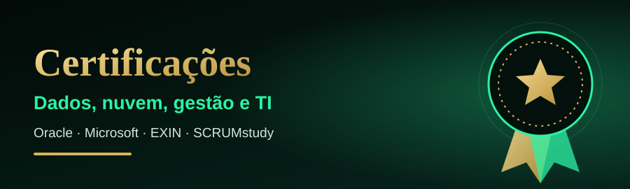

  

Certificações que concluí em dados, nuvem, gestão ágil e TI. **Todas estão válidas.**

## ☁️ Dados, nuvem e IA 

| Certificação | Instituição | Ano | Status |
|---|---|---|---|
| Oracle Cloud Infrastructure Certified AI Foundations Associate | Oracle | 2026 | ✅ Válida até 2028 |
| Microsoft Certified: Azure Fundamentals (AZ-900) | Microsoft | 2023 | ✅ Válida |

## 🧭 Gestão e agilidade

| Certificação | Instituição | Ano | Status |
|---|---|---|---|
| Scrum Fundamentals | SCRUMstudy | 2017 | ✅ Válida |

## 🛡️ TI e segurança

| Certificação | Instituição | Ano | Status |
|---|---|---|---|
| ITIL® Foundation in IT Service Management | EXIN | 2015 | ✅ Válida |
| Information Security Foundation based on ISO/IEC 27001 | EXIN | 2015 | ✅ Válida |
| Green IT Citizen | EXIN | 2015 | ✅ Válida |

## 🚀 Em preparação

- Microsoft **DP-600** (Fabric Analytics Engineer)
- Microsoft **PL-300** (Power BI Data Analyst)

---

*Os certificados completos podem ser apresentados mediante solicitação.*

**Autoria:** Luana Ferreira de Sousa · [LinkedIn](https://www.linkedin.com/in/luaferreira-desousa/)
